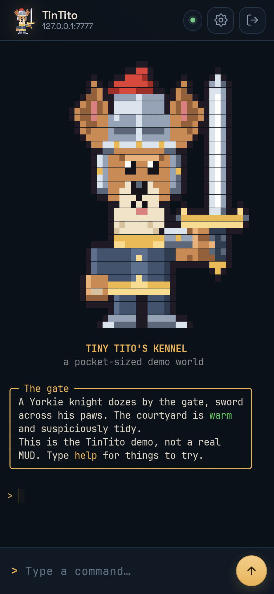

# TinTito



A pocket-sized MUD client: a real ANSI terminal in a PWA, plus a tiny Bun
bridge for raw telnet. Named for **Tito**, the Yorkie knight, with a nod to
**TinTin++**, the classic MUD client.

## What it does

- **Proper ANSI**, not a text log: 16/256/truecolor SGR, cursor addressing,
  erase/insert/delete, scroll regions, alternate screen, DEC special graphics
  (box drawing), tab stops, and a 2,000-line scrollback with soft-wrap reflow.
- **Text art stays aligned** with modern monospace fonts: JetBrains Mono
  (default), IBM Plex Mono, or the system monospace. The UI uses Space Grotesk.
- **Telnet negotiation** in the bridge: NAWS (terminal size), TTYPE
  (`XTERM-256COLOR`), CHARSET (UTF-8), ECHO, and SGA. MCCP, MXP, GMCP, MSDP,
  MSSP, and friends are declined so servers send plain text.
- **Encodings** for old art: UTF-8, CP437, and Windows-1252. Non-UTF-8 choices
  also stop the bridge from asking the MUD for UTF-8.
- **Phone-shaped**: dynamic viewport sizing, safe areas, on-screen keyboard,
  command history (↑/↓), big send button, scroll-up jump pill, rotation-safe
  terminal reflow.
- **Installable PWA**: offline shell, app icons, two themes (Midnight kennel,
  Parchment), and remembered preferences.
- **TLS to the MUD** when the server offers a valid certificate.
- Optional **demo world** with truecolor half-block mascot art and a few
  commands.

Browsers cannot open raw TCP sockets, so TinTito has two pieces:

```text
phone / browser  ──WebSocket──▶  Bun bridge  ──TCP/TLS──▶  MUD
```

The bridge is intentionally small. It owns the telnet parser, so the browser
never sees telnet verbs, and the terminal only sees a byte stream to render.

## Quick start

Requires [Bun](https://bun.sh) 1.2 or newer. There are no runtime npm
dependencies.

```bash
bun run start
# open http://localhost:3000
```

Use a different port with `PORT=8080 bun run start`. The server binds
`0.0.0.0` by default so a phone on the same network can reach it; set
`HOST=127.0.0.1` to keep it local.

Pick a preset (Aardwolf, Alter Aeon, Discworld) or enter a host and port.
The TLS switch is for MUDs with a TLS listener and a valid certificate.

### Try the demo world

```bash
# terminal 1
bun run demo

# terminal 2
ALLOW_PRIVATE=1 bun run start
```

Connect to `127.0.0.1:7777`. The demo is clearly labeled as a demo; it shows
256-colour swatches (`colors`), a truecolor mascot, box drawing, and commands
such as `look`, `help`, and `pet tito`.

`ALLOW_PRIVATE=1` is required because the demo lives on loopback. Leave it off
for ordinary public MUDs.

### Put it on your phone

1. Run the server somewhere your phone can reach.
2. Serve it over HTTPS. Two easy options:
   - **Tailscale**: `tailscale serve --bg 3000`, then open the HTTPS URL.
   - **Caddy** in front of Bun:

     ```caddyfile
     mud.example.com {
       reverse_proxy 127.0.0.1:3000
     }
     ```

3. Open the HTTPS URL, then use **Install app** (Chrome/Android) or
   **Share → Add to Home Screen** (iOS Safari).

Service workers and install prompts need a secure context. Plain HTTP on a LAN
still plays, but it will not install or cache offline.

## Security notes

This is a self-hosted personal tool, not a public proxy service.

- The bridge blocks target IPs that are loopback, private, link-local, CGNAT,
  multicast, or unique-local IPv6 **unless** `ALLOW_PRIVATE=1`. It resolves
  hostnames and checks every resolved address. Do not set `ALLOW_PRIVATE=1` on
  a publicly reachable instance.
- WebSocket upgrades validate `Origin` against `Host` when an Origin header is
  present, which blocks ordinary cross-site WebSocket abuse.
- There is no authentication and no per-IP rate limit. If you expose TinTito to
  the internet, put it behind auth/VPN and a rate limiter.
- The bridge terminates TLS to the MUD, so it can read that traffic. It does
  not log it itself.
- Self-signed MUD certificates are rejected.
- WS frames are capped at 16 KiB; user commands are capped at 2 KiB.

Environment variables: `PORT` (3000), `HOST` (`0.0.0.0`), `ALLOW_PRIVATE`
(`0`), `DEMO_PORT` (7777), `DEMO_HOST` (`127.0.0.1`).

## Terminal details

- SGR: bold, dim, italic, underline, blink, inverse, hidden, strike, standard
  and bright 16 colours, 256-colour cube, and 24-bit truecolour.
- CSI: cursor movement and addressing, erase display/line, insert/delete
  lines/chars, erase chars, scroll up/down, scroll regions, tab clear, save/
  restore, device status reports.
- Modes: autowrap, cursor visibility, insert, origin, alternate screen
  (`?47`, `?1047`, `?1049`), plus a small DEC special-graphics charset map for
  BBS-style art.
- OSC: window title and hyperlink metadata. Links are not auto-launched.
- Reflow: resizing joins soft-wrapped rows, re-wraps at the new width, and keeps
  colours; the bridge sends NAWS so future output matches.
- Fonts are deliberately monospace. Proportional fonts would break box art.
  Ligatures are disabled for the same reason.
- Charset decoding happens in the browser; switch it in Settings if a legacy
  MUD's CP437 art looks garbled.

## Store packaging

TinTito is an installable PWA, not a native app checked into this repo, and
publishing to an app store needs accounts and signing material that are not
part of the source:

- **Google Play**: host this bridge on a stable HTTPS URL, then wrap the PWA as
  a Trusted Web Activity with
  [Bubblewrap](https://github.com/GoogleChromeLabs/bubblewrap) or
  [PWABuilder](https://www.pwabuilder.com/). Upload the signed AAB through a
  Google Play Console account. The TWA needs Digital Asset Links at
  `/.well-known/assetlinks.json` for that URL and signing key.
- **Apple App Store**: requires a WKWebView/Capacitor wrapper built with Xcode
  on macOS and an Apple Developer account. On iPhone today, Safari's
  **Share → Add to Home Screen** installs the PWA without the store.
- **Privacy policy**: `/privacy.html` is included for store listings.

No store account, production domain, upload key, or signing certificate is
included here. Publishing cannot be completed without those.

## Development

```bash
bun test                 # terminal, telnet, bridge integration (no browser)
bun run check            # type/syntax check
bun run icons            # regenerate SVG/PNG icons from tools/logo.py
```

The unit tests cover wrapping, CR rewriting, cursor ops, erase, scrolling,
scroll regions, alt screen, SGR, DEC graphics, combining/wide characters, OSC,
reflow, CP437, telnet negotiation, NAWS, charset, and a real WebSocket bridge
round-trip against a mock MUD.

For the browser smoke test:

```bash
bun install
bun x playwright install chromium
bun run demo                        # terminal 1
ALLOW_PRIVATE=1 PORT=8080 bun run start   # terminal 2
bun run ui-smoke
```

Screenshots land in `artifacts/` (gitignored). The smoke test drives the form,
sends commands, checks scroll pinning, opens settings, swaps to IBM Plex Mono,
and rotates to landscape.

### Layout

```text
public/          PWA: index.html, app.js, terminal.js, style.css, fonts, icons, sw.js
server/server.js Bun HTTP/WebSocket bridge + static server
server/telnet.js Telnet filter (NAWS/TTYPE/CHARSET/ECHO/SGA)
tools/logo.py    Pixel mascot -> SVG, PNG icons, demo grid
tools/demo-mud.js Demo MUD with truecolor half-block art
tools/ui-smoke.js Playwright smoke test
test/            Unit and integration tests
assets/          Source mascot, screenshots
```

## Limits

- No aliases, triggers, timers, scripting, logging, or GMCP/MSDP map data.
- No MCCP decompression; servers that support it are told not to compress.
- No self-signed TLS, client certificates, or proxy authentication.
- No local echo in the browser; the MUD echoes input as usual. Password fields
  are therefore not masked.
- One connection per tab; scrollback is in-memory only.

## Credits and licences

- Code: MIT (see `LICENSE`).
- JetBrains Mono, IBM Plex Mono, and Space Grotesk: SIL Open Font License 1.1.
  Licence texts are in `public/fonts/OFL-*.txt`.
- The Yorkie knight mascot is original pixel art generated by
  `tools/logo.py`.
- Thanks to the Aardwolf, Alter Aeon, and Discworld folks for keeping text
  worlds online.
